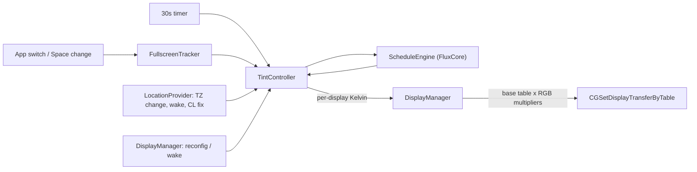

# Architecture

## 1. Overview & Toolchain

A Swift package built with **SwiftPM** and the Command Line Tools only (no Xcode).

- **Language:** Swift 6 language mode (strict concurrency). App-target types are `@MainActor`.
- **Target OS:** macOS 14.0+ (developed on macOS 26.x).
- **Frameworks:** Foundation, AppKit, CoreGraphics, CoreLocation. No third-party dependencies.
- **Tests:** Swift Testing (`import Testing`), because the Command Line Tools don't ship XCTest. Run them with `./scripts/test.sh`, not bare `swift test` (see [ADR 006](DECISIONS.md)).

| Command | What it does |
|---|---|
| `swift build` | Debug build of everything |
| `./scripts/test.sh` | Unit tests for `FluxCore` (wraps `swift test` with the flags Swift Testing needs) |
| `./scripts/build-app.sh` | Release build, wrapped in an ad-hoc signed `build/Flux.app` |

If an agent sandbox blocks SwiftPM (`sandbox-exec: sandbox_apply: Operation not permitted`), run the command outside the sandbox. SwiftPM sandboxes its own manifest compilation, and that can't nest.

---

## 2. Module Layout

```
Flux/
├── Package.swift
├── Sources/
│   ├── FluxCore/                          # Pure logic, Foundation + CoreGraphics geometry types only
│   │   ├── Solar/SolarCalculator.swift    # NOAA solar elevation, sunrise/sunset for a local day
│   │   ├── Color/ColorTemperature.swift   # Kelvin → RGB multipliers, mired-space blending
│   │   ├── Color/GammaTable.swift         # Transfer tables; scale a base table by RGB
│   │   ├── Color/DisplayTarget.swift      # Kelvin or darkroom target per display; TargetFade between them
│   │   ├── Schedule/ScheduleEngine.swift  # Day / sunset / bedtime target for an instant
│   │   ├── Schedule/TemporaryDisable.swift# "For an hour" / "until sunrise" pauses
│   │   ├── Schedule/TintMode.swift        # Movie / darkroom modes + TargetResolver (precedence rules)
│   │   ├── Schedule/BedtimeReminder.swift # When to notify, and the message
│   │   ├── Location/ZoneTab.swift         # Parser for /usr/share/zoneinfo/zone.tab
│   │   ├── Location/LocationResolver.swift# Picks manual / Core Location / time-zone coordinates
│   │   ├── Display/FullscreenGeometry.swift # Which displays a full-screen window covers
│   │   └── Models/                        # Coordinates, UserSettings (Codable, tolerant of missing keys)
│   │
│   └── FluxApp/                           # Thin macOS layer (executable)
│       ├── main.swift                     # NSApplication, accessory (menu-bar only) policy
│       ├── AppDelegate.swift              # Wiring, restore on quit, SIGINT/SIGTERM/SIGHUP via DispatchSource
│       ├── TintController.swift           # @Observable; schedule + modes + disables + preview → per-display targets
│       ├── SettingsStore.swift            # @Observable UserSettings, JSON in UserDefaults ("settings" key)
│       ├── Display/DisplayManager.swift   # All gamma writes, base tables, fades, reconfig + wake handling
│       ├── WindowAndSpace/FullscreenTracker.swift # Window list → full-screen displays; app/Space notifications
│       ├── Location/LocationProvider.swift # One-shot Core Location, time-zone change + wake refresh
│       ├── System/LaunchAtLogin.swift     # SMAppService.mainApp
│       ├── System/AppearanceSync.swift    # Light/Dark Mode via osascript → System Events
│       ├── System/Notifier.swift          # UNUserNotificationCenter (bundle only)
│       ├── UI/StatusItemManager.swift     # NSStatusItem menu
│       └── UI/PreferencesView.swift       # SwiftUI settings form + PreferencesWindowController
│
├── Tests/FluxCoreTests/                   # Swift Testing suites for everything in FluxCore
├── scripts/
│   ├── test.sh                            # swift test + Swift Testing search paths for the CLT
│   └── build-app.sh                       # Assembles and ad-hoc signs build/Flux.app
├── reference/                             # f.lux decompilation exports (see REVERSE_ENGINEERING.md)
└── docs/
```


---

## 3. Data Flow



1. `TintController.refresh` runs every 30 s and whenever an input changes.
2. It resolves coordinates (`LocationResolver`) and asks `ScheduleEngine` for the scheduled Kelvin.
3. `TargetResolver` picks each display's `DisplayTarget`. Precedence: settings-slider preview, then temporary disable (neutral), then darkroom, then the per-app or full-screen disable (neutral), then movie mode (`max(scheduled, 4100 K)`), then the schedule ([ADR 009](DECISIONS.md)).
4. `DisplayManager` fades each display towards its target (30 Hz while fading). Kelvin-to-Kelvin fades go through mired space; fades involving darkroom cross-fade the tables.
5. After each refresh: dark-mode sync (edge-triggered on `ScheduleResult.prefersDarkAppearance`, i.e. daylight < 0.5) and the bedtime-reminder check.

### Modes
- **Movie mode:** 2.5 h. It never warms past 4100 K but doesn't cool a cooler schedule. It still respects the full-screen disable.
- **Darkroom:** lasts until the next morning (the later of sunrise and wake time). It shows red only, using the display's inverted red curve. It overrides the per-app and full-screen disables but not a temporary disable.
- **Preview:** moving a settings slider shows that Kelvin on every display for 3 s after the last change.

### Schedule model (`ScheduleEngine`)
Two weights are blended in **mired** space (1e6/K):
- **Daylight**: ramps up over `transitionMinutes`, starting at the later of sunrise and wake time. Ramps down over `transitionMinutes` starting at sunset (sun at -0.833°). During polar day or night it follows the current solar elevation.
- **Bedtime**: ramps up over `transitionMinutes`, ending at bedtime (= wake time - `sleepMinutes`). Holds until wake time, then ramps down. It wraps past midnight correctly.

`kelvin = blend(blend(sunset, day, daylight), bedtime, bedtimeWeight)`. Defaults are 6500 / 3400 / 2300 K, wake time 07:00 and 8 h 30 min of sleep (so bedtime is 22:30), with 60 min transitions.

### Colour (`ColorTemperature`)
The Planckian locus (Krystek approximation) is converted to linear sRGB, divided by the 6500 K values so that 6500 K is exactly white, normalised so the brightest channel is 1, then sRGB-encoded. The multipliers scale the display's **own** transfer table, so calibration is kept.

### Full-screen detection (`FullscreenTracker` + `FullscreenGeometry`)
- It reads `CGWindowListCopyWindowInfo([.optionOnScreenOnly, .excludeDesktopElements])`, which is ordered front to back, and ignores Flux's own windows and fully transparent ones.
- For each display, it takes the **topmost** window on layer 0 (normal) or at the shielding level that intersects the display. If that window covers `CGDisplayBounds`, the display is "full screen". It works this way so that a full-screen video on display B is found even while you're working in another app on display A ([ADR 008](DECISIONS.md)).
- `kCGWindowBounds` and `CGDisplayBounds` share a top-left-origin global space. Don't compare against `NSScreen.frame`, which has a bottom-left origin.
- The camera notch: full-screen windows sit below it, so `NSScreen.safeAreaInsets.top` is allowed as slack at the top.
- Bounds and layers don't need Screen Recording permission; window *names* would.
- Checks run on app activation and Space change (again 1 s later, after the Space animation), and on the 30 s tick.
- Known edge case: with an auto-hiding menu bar, a zoomed (green-button-option) window fills the screen and counts as full screen.

### Location (`LocationProvider` + `LocationResolver`)
The order is: manual coordinates, then the last Core Location fix **if it was taken in the current time zone**, then the `zone.tab` coordinates for `TimeZone.current`, then a longitude estimated from the UTC offset. On `NSSystemTimeZoneDidChange` the provider calls `NSTimeZone.resetSystemTimeZone()`, recalculates at once (using `zone.tab` until a new fix arrives) and requests a fresh fix. Wake also requests a fix. Core Location is used only when the bundle declares `NSLocationUsageDescription`, so `swift run` builds use `zone.tab` ([ADR 007](DECISIONS.md)).

---

## 4. Key macOS APIs & Safety

| Purpose | API | Notes |
|---|---|---|
| Read calibrated table | `CGGetDisplayTransferByTable` | Captured after `CGDisplayRestoreColorSyncSettings()` at launch and after every reconfiguration or wake |
| Apply tint | `CGSetDisplayTransferByTable` | Gamma only. No ICC profiles are written ([ADR 003](DECISIONS.md)) |
| Restore | `CGDisplayRestoreColorSyncSettings()` | On quit and on SIGINT/SIGTERM/SIGHUP (DispatchSource leads to `NSApp.terminate`). On a crash, macOS restores the settings when the process exits |
| Display changes | `CGDisplayRegisterReconfigurationCallback`, `NSWorkspace.didWake/screensDidWake` | Debounced 0.75 s, then tables are recaptured and reapplied |
| Full-screen check | `CGWindowListCopyWindowInfo`, `CGDisplayBounds`, `NSScreen.safeAreaInsets` | See above |
| App / Space events | `NSWorkspace.didActivateApplicationNotification`, `activeSpaceDidChangeNotification` | |
| Location | `CLLocationManager.requestLocation()` (kilometre accuracy) | One-shot fixes only, no continuous tracking |
| Time zone | `NSSystemTimeZoneDidChange` + `NSTimeZone.resetSystemTimeZone()` | No UI, ever |
| Start at login | `SMAppService.mainApp.register()/unregister()` | `.requiresApproval` → button opens Login Items settings |
| Dark Mode | `osascript -e 'tell application "System Events" to tell appearance preferences to set dark mode to …'` | Needs `NSAppleEventsUsageDescription`; one Automation prompt ([ADR 010](DECISIONS.md)) |
| Notifications | `UNUserNotificationCenter` | Skipped when there is no bundle ID; delegate forces banners |

**Conflicts:** macOS Night Shift and the original f.lux both change the display output. Turn them off while testing. Night Shift isn't detected yet.

---

## 5. Packaging

`scripts/build-app.sh` runs `swift build -c release --product FluxApp` and lays out:

```
build/Flux.app/Contents/
├── Info.plist      # com.mduppes.flux, LSUIElement, LSMinimumSystemVersion 14.0, location + Apple Events usage strings
└── MacOS/FluxApp
```

It then signs ad hoc (`codesign --force --sign -`). Because each rebuild changes the ad-hoc signature, macOS may ask for location permission again.
