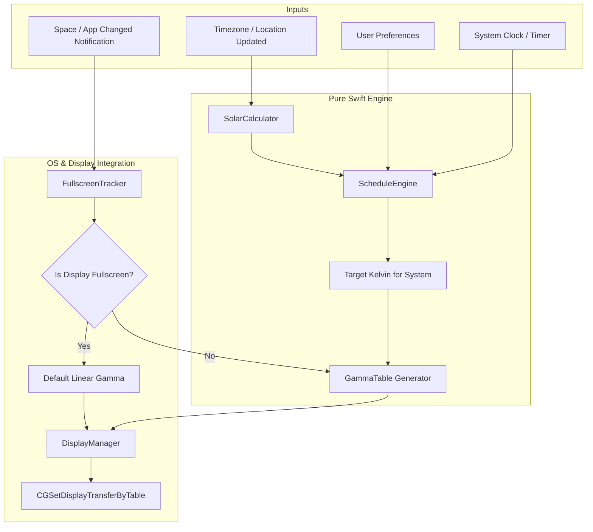

# Architecture & Implementation Plan

## 1. Overview & Toolchain

The project is structured as a clean Swift package built using **SwiftPM** (Command Line Tools), requiring no full Xcode IDE installation.

- **Language:** Swift 6.0+ (utilizing modern Swift Concurrency: `Sendable`, actors, async/await).
- **Target OS:** macOS 14.0+ (Sonoma) and later (tested on macOS 26.x Command Line Tools).
- **Dependencies:** Pure standard library, Foundation, AppKit, CoreGraphics, CoreLocation, ServiceManagement. Zero third-party dependencies.

---

## 2. Module Layout

```
Flux/
├── Package.swift
├── Sources/
│   ├── FluxCore/                      # Pure business logic (Library)
│   │   ├── Solar/
│   │   │   └── SolarCalculator.swift  # Solar altitude, sunrise/sunset times
│   │   ├── Color/
│   │   │   ├── ColorTemperature.swift # Kelvin to RGB conversion
│   │   │   └── GammaTable.swift       # 256/1024-entry gamma LUT generation
│   │   ├── Schedule/
│   │   │   ├── ScheduleEngine.swift   # Evaluates current target Kelvin
│   │   │   └── ScheduleState.swift    # Day / Sunset / Bedtime phases
│   │   └── Models/
│   │       ├── Coordinates.swift      # Latitude / Longitude representation
│   │       └── UserSettings.swift     # Preferences model
│   │
│   └── FluxApp/                       # macOS menu-bar app (Executable)
│       ├── Main.swift                 # App entry point (NSApplication, LSUIElement)
│       ├── AppDelegate.swift          # App lifecycle, signal handling, cleanup
│       ├── Display/
│       │   ├── DisplayManager.swift   # CGSetDisplayTransferByTable & restore
│       │   └── DisplayReconfig.swift  # Display connect/disconnect listener
│       ├── WindowAndSpace/
│       │   └── FullscreenTracker.swift# Per-display window detection
│       ├── Location/
│       │   ├── LocationProvider.swift # CoreLocation wrapper
│       │   └── TimezoneFallback.swift # Coordinate lookup by timezone ID
│       ├── UI/
│       │   ├── StatusItemManager.swift# Menu bar icon and quick controls
│       │   └── PreferencesView.swift  # SwiftUI settings window
│       └── System/
│           ├── LaunchAtLogin.swift    # SMAppService wrapper
│           └── DarkModeSync.swift     # Automatic macOS dark mode toggle
│
├── Tests/
│   └── FluxCoreTests/
│       ├── SolarCalculatorTests.swift # Verification against known solar data
│       ├── ColorTemperatureTests.swift# Verification of RGB curves
│       └── ScheduleEngineTests.swift  # Phase transition & wake time tests
│
├── scripts/
│   └── build-app.sh                   # Assembles Flux.app bundle and ad-hoc signs
└── docs/                              # Project documentation
```

---

## 3. Core Components & Data Flow



### Data Flow Details:
1. **Periodic Evaluation:** A background timer fires every 30 seconds (or immediately on system wake/time change).
2. **Phase Determination:** `ScheduleEngine` calculates the sun's altitude angle for the current time and coordinates. It blends daytime, sunset, and bedtime temperatures based on the solar curve and configured wake time.
3. **Display Inspection:** `FullscreenTracker` queries `CGWindowListCopyWindowInfo` to determine which displays are running fullscreen windows.
4. **Gamma Table Application:** For each connected display (`CGGetActiveDisplayList`):
   - If the display is occupied by a fullscreen application, linear (neutral) gamma is applied.
   - If the frontmost application is disabled in settings, linear gamma is applied.
   - Otherwise, the interpolated warm gamma table is applied using `CGSetDisplayTransferByTable`.

---

## 4. Key macOS APIs & Safety Mechanisms

| Purpose | API | Implementation Note |
|---|---|---|
| Apply Gamma | `CGSetDisplayTransferByTable(displayID, count, redTable, greenTable, blueTable)` | Manipulates hardware gamma LUT without altering user ICC profiles. |
| Restore Gamma | `CGDisplayRestoreColorSyncSettings()` | **Crucial safety call:** Invoked in `applicationWillTerminate`, `SIGINT`, `SIGTERM`, and crash handlers. |
| Monitor Displays | `CGDisplayRegisterReconfigurationCallback` | Detects monitor sleep, wake, connect, disconnect, and display mirror changes. |
| Detect Fullscreen | `CGWindowListCopyWindowInfo(kCGWindowListOptionOnScreenOnly, kCGNullWindowID)` | Returns window bounds and layer numbers to compare against `NSScreen.screens`. |
| App Focus Events | `NSWorkspace.didActivateApplicationNotification`, `activeSpaceDidChangeNotification` | Triggers immediate per-display fullscreen check. |
| Start at Login | `SMAppService.mainApp.register()` / `unregister()` | Modern macOS 13+ standard service management. |
| Timezone Updates | `NotificationCenter.default.addObserver(..., name: NSSystemTimeZoneDidChangeNotification)` | Recomputes solar times instantly when system clock/timezone changes. |

---

## 5. Build & Packaging Architecture

Because only Command Line Tools are present:
1. `swift build -c release` compiles the `FluxApp` binary.
2. `scripts/build-app.sh` creates the `.app` bundle:
   ```
   build/Flux.app/
   └── Contents/
       ├── Info.plist            (Sets LSUIElement=1, bundle ID, CFBundleExecutable)
       ├── MacOS/
       │   └── FluxApp           (The compiled executable)
       └── Resources/
           └── AppIcon.icns
   ```
3. The script signs the bundle ad-hoc (`codesign --force --deep --sign - build/Flux.app`).
